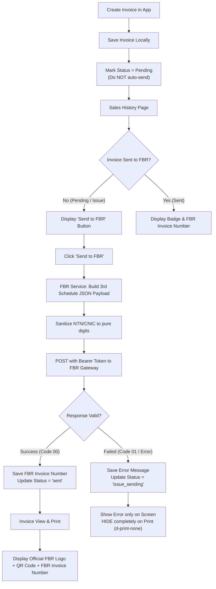

# FBR IRIS Digital Invoicing Integration Guide

## Complete Technical Blueprint & AI-Ready Implementation Specification

### Focus: General Digital Invoicing & "Sale of 3rd Schedule Goods" Compliance

---

## 📌 Executive Summary & Purpose

This document provides a comprehensive, end-to-end engineering guide for integrating Pakistan's **Federal Board of Revenue (FBR) IRIS Digital Invoicing (DI) API** into any ERP, POS, or billing software.

It is written specifically so that any developer or AI coding assistant (Antigravity, Cursor, Claude Code, GitHub Copilot, etc.) can read this document and implement the integration seamlessly from scratch into any technology stack (PHP/Laravel, Node/Express/Nest, Python/Django/FastAPI, .NET, Go, etc.).

---

## 🏛️ 1. Regulatory Context & "3rd Schedule Goods" Rules

Under the **Sales Tax Act, 1990** and relevant Sales Tax General Orders (STGOs), registered taxpayers must report digital tax invoices in real time to the FBR IRIS portal via the PRAL Gateway.

### Key Rule for "Sale of 3rd Schedule Goods":

For standard items, sales tax is calculated _ad valorem_ on the wholesale/transaction value (`valueSalesExcludingST`).
However, for goods specified under the **Third Schedule** (such as ice cream, beverages, confectioneries, cosmetics, toiletries, household electrical goods, packaged edible items, etc.):

1. **Tax Base = Printed Retail Price (MRP):** Under **Section 3(2)(a)**, sales tax must be charged strictly on the **Maximum Retail Price (MRP)** printed legibly on the packaging, regardless of any trade discount or wholesale price charged to distributors/retailers.
2. **Payload Field Mapping:**
    - `saleType` must be set to `"3rd Schedule Goods"`.
    - `fixedNotifiedValueOrRetailPrice` must be set to the **Total Retail Price** (`Unit Retail Price * Total Quantity`).
    - `salesTaxApplicable` must be computed as:
      $$\text{salesTaxApplicable} = \text{fixedNotifiedValueOrRetailPrice} \times \left(\frac{\text{Tax Rate}}{100}\right)$$
    - `valueSalesExcludingST` carries the transaction value excluding sales tax.
3. **Validation Failure:** If `salesTaxApplicable` is computed on `valueSalesExcludingST` instead of `fixedNotifiedValueOrRetailPrice`, FBR's gateway will instantly reject the payload with error:
    > _"Provided sales tax amount does not match the calculated sales tax amount in case of 3rd schedule goods"_

---

## 🌐 2. API Endpoints & Authentication

### 2.1 Gateway URLs

| Environment           | Endpoint URL                                             | Description                                                       |
| :-------------------- | :------------------------------------------------------- | :---------------------------------------------------------------- |
| **Sandbox (Testing)** | `https://gw.fbr.gov.pk/di_data/v1/di/postinvoicedata_sb` | Testing scenarios (e.g. SN008), mock tokens, sandbox verification |
| **Production (Live)** | `https://gw.fbr.gov.pk/di_data/v1/di/postinvoicedata`    | Live fiscal invoice transmission                                  |

### 2.2 HTTP Headers

```http
POST /di_data/v1/di/postinvoicedata HTTP/1.1
Host: gw.fbr.gov.pk
Authorization: Bearer <YOUR_SECURITY_TOKEN>
Content-Type: application/json
Accept: */*
Accept-Language: en-US
User-Agent: <AppName>/1.0
```

### 2.3 Registration Number Formatting (Crucial)

The FBR API gateway enforces strict validation on `sellerNTNCNIC` and `buyerNTNCNIC`:

- **Companies / Partnerships (AOP):** Must be **exact 7 digits** without hyphens (e.g. `1234567`). If an 8-character string with a check digit is stored (e.g. `1234567-8`), strip the hyphen and check digit to supply only the 7 digits.
- **Individuals / Sole Proprietors:** Must be **exact 13 digits** without hyphens (e.g. `4210112345671`).
- **Unregistered End-Consumers:** Supply `9999999` or `9999999999999`.

> ⚠️ **Common Failure:** If hyphens (`-`) or spaces are passed, FBR returns:
> _"Unauthorized access: Provided seller registration number is not 13 digits (CNIC) or 7 digits (NTN) or the authorized token does not exist against seller registration number"_.
> **Always sanitize registration numbers programmatically to numeric-only digits.**

---

## 📋 3. JSON Request & Response Contracts

### 3.1 Request Payload Schema (Sale of 3rd Schedule Goods)

```json
{
    "invoiceType": "Sale Invoice",
    "invoiceDate": "2026-11-18",
    "sellerNTNCNIC": "1234567",
    "sellerBusinessName": "JAFFAR MARKETING",
    "sellerProvince": "Sindh",
    "sellerAddress": "Commercial Area, Karachi",
    "buyerNTNCNIC": "7654321",
    "buyerBusinessName": "Al-Rehman Super Mart",
    "buyerProvince": "Sindh",
    "buyerAddress": "Shop 4, Main Road, Karachi",
    "buyerRegistrationType": "Registered",
    "invoiceRefNo": "INV-1025",
    "scenarioId": "SN008",
    "items": [
        {
            "hsCode": "2105.0000",
            "productDescription": "Dairy Ice Cream 500ml Tub",
            "rate": "18%",
            "uoM": "Numbers, pieces, units",
            "quantity": 10.0,
            "totalValues": 1500.0,
            "valueSalesExcludingST": 1200.0,
            "fixedNotifiedValueOrRetailPrice": 1500.0,
            "salesTaxApplicable": 270.0,
            "salesTaxWithheldAtSource": 0.0,
            "extraTax": 0.0,
            "furtherTax": 0.0,
            "sroScheduleNo": "",
            "fedPayable": 0.0,
            "discount": 0.0,
            "saleType": "3rd Schedule Goods",
            "sroItemSerialNo": ""
        }
    ]
}
```

#### Field Specifications:

| Key                                           | Type   | Description                                                        |
| :-------------------------------------------- | :----- | :----------------------------------------------------------------- |
| `invoiceType`                                 | String | Fixed: `"Sale Invoice"`                                            |
| `invoiceDate`                                 | String | Format `YYYY-MM-DD`                                                |
| `sellerNTNCNIC`                               | String | 7 digits (NTN) or 13 digits (CNIC) of seller                       |
| `sellerBusinessName`                          | String | Registered business name in IRIS portal                            |
| `sellerProvince`                              | String | Seller's registered tax province                                   |
| `sellerAddress`                               | String | Seller's physical business address                                 |
| `buyerNTNCNIC`                                | String | Buyer's NTN (7 digits), CNIC (13 digits), or `9999999`             |
| `buyerBusinessName`                           | String | Buyer / Business Name                                              |
| `buyerProvince`                               | String | Buyer's Province (`Sindh`, `Punjab`, `Khyber Pakhtunkhwa`, etc.)   |
| `buyerAddress`                                | String | Buyer's Delivery / Business Address                                |
| `buyerRegistrationType`                       | String | `"Registered"` or `"Unregistered"`                                 |
| `invoiceRefNo`                                | String | Internal invoice number (e.g. `INV-1025`)                          |
| `scenarioId`                                  | String | Mandatory for Sandbox (`SN008` for 3rd schedule); optional in Prod |
| **`items[].hsCode`**                          | String | 8-digit Harmonized System classification code                      |
| **`items[].productDescription`**              | String | Item name/description                                              |
| **`items[].rate`**                            | String | Tax rate string ending with `%` (e.g. `"18%"`)                     |
| **`items[].uoM`**                             | String | Unit of measure (e.g. `"Numbers, pieces, units"`, `"Pieces"`)      |
| **`items[].quantity`**                        | Float  | Physical units sold                                                |
| **`items[].fixedNotifiedValueOrRetailPrice`** | Float  | **Total Printed Retail Price** ($Qty \times \text{Unit MRP}$)      |
| **`items[].salesTaxApplicable`**              | Float  | **Tax on MRP** ($\text{Retail Price} \times 18\%$)                 |
| **`items[].valueSalesExcludingST`**           | Float  | Net transaction value excluding sales tax                          |
| **`items[].totalValues`**                     | Float  | Gross item value                                                   |
| **`items[].saleType`**                        | String | Mandatory: `"3rd Schedule Goods"`                                  |

---

### 3.2 FBR Success Response

```json
{
    "invoiceNumber": "7000007DI1747119701593",
    "dated": "2026-11-18 22:00:00",
    "validationResponse": {
        "statusCode": "00",
        "status": "Valid",
        "error": "",
        "invoiceStatuses": [
            {
                "itemSNo": "1",
                "statusCode": "00",
                "status": "Valid",
                "invoiceNo": "7000007DI1747119701593-1",
                "errorCode": "",
                "error": ""
            }
        ]
    }
}
```

> When `status` is `"Valid"` or `statusCode` is `"00"`, extract `invoiceNumber` (or `validationResponse.invoiceStatuses[0].invoiceNo`). Store it permanently as the **FBR Invoice Number / IRN**.

### 3.3 FBR Error Response

```json
{
    "invoiceNumber": "",
    "dated": "2026-11-18 22:00:00",
    "validationResponse": {
        "statusCode": "01",
        "status": "Invalid",
        "error": "Provided sales tax amount does not match the calculated sales tax amount in case of 3rd schedule goods",
        "invoiceStatuses": [
            {
                "itemSNo": "1",
                "statusCode": "01",
                "status": "Invalid",
                "error": "Provided sales tax amount does not match the calculated sales tax amount in case of 3rd schedule goods"
            }
        ]
    }
}
```

---

## 🗄️ 4. Database Schema Requirements

To integrate FBR in any software, ensure the following tables/columns are present:

### 4.1 FBR Settings Table (`fbr_settings`)

| Column                 | Type    | Default                                                  | Notes                                |
| :--------------------- | :------ | :------------------------------------------------------- | :----------------------------------- |
| `token`                | Text    | `null`                                                   | Bearer Token from IRIS portal        |
| `seller_ntn_cnic`      | String  | `null`                                                   | Cleaned 7-digit NTN or 13-digit CNIC |
| `seller_business_name` | String  | `null`                                                   | Official legal business name         |
| `seller_province`      | String  | `'Sindh'`                                                | Registered province                  |
| `seller_address`       | Text    | `null`                                                   | Physical registered address          |
| `environment`          | String  | `'sandbox'`                                              | `'sandbox'` or `'production'`        |
| `sandbox_url`          | String  | `https://gw.fbr.gov.pk/di_data/v1/di/postinvoicedata_sb` | Sandbox endpoint                     |
| `production_url`       | String  | `https://gw.fbr.gov.pk/di_data/v1/di/postinvoicedata`    | Production endpoint                  |
| `scenario_id`          | String  | `'SN008'`                                                | Default test scenario                |
| `sale_type`            | String  | `'3rd Schedule Goods'`                                   | Sale type identifier                 |
| `default_hs_code`      | String  | `'2105.0000'`                                            | Fallback HS code                     |
| `default_tax_rate`     | Float   | `18.0`                                                   | Standard tax percentage              |
| `is_active`            | Boolean | `true`                                                   | Integration toggle                   |

### 4.2 Sales / Invoices Table Extensions (`sales`)

| Column                    | Type      | Default          | Description                              |
| :------------------------ | :-------- | :--------------- | :--------------------------------------- |
| `fbr_status`              | String    | `'pending'`      | `'pending'`, `'sent'`, `'issue_sending'` |
| `fbr_invoice_number`      | String    | `null`           | Unique IRN assigned by FBR               |
| `fbr_submitted_at`        | Timestamp | `null`           | Date & time of successful submission     |
| `fbr_response`            | LongText  | `null`           | Raw JSON response from FBR               |
| `fbr_error`               | Text      | `null`           | Extracted failure description            |
| `buyer_ntn_cnic`          | String    | `null`           | Buyer NTN/CNIC snapshot                  |
| `buyer_name`              | String    | `null`           | Buyer Name snapshot                      |
| `buyer_province`          | String    | `null`           | Buyer Province snapshot                  |
| `buyer_address`           | Text      | `null`           | Buyer Address snapshot                   |
| `buyer_registration_type` | String    | `'Unregistered'` | `'Registered'` or `'Unregistered'`       |

### 4.3 Customer / Accounts Master Table (`accounts` / `customers`)

- `province` (String): e.g. `'Sindh'`, `'Punjab'`
- `registration_type` (String): `'Registered'` or `'Unregistered'`

### 4.4 Products Master Table (`products`)

- `hs_code` (String): 8-digit HS Code (e.g. `'2105.0000'`)

---

## ⚙️ 5. Implementation Architecture & Workflow



### 5.1 Manual Dispatch Rule

- Saving a new invoice creates the database record and sets `fbr_status = 'pending'`.
- It does **not** transmit immediately. The user can review, edit, or dispatch in batch.
- Dispatch is triggered via a **"Send to FBR"** button in Sales History or Invoice View.

### 5.2 Print Visibility Rules

- **If Sent to FBR (`fbr_status === 'sent'`):**
    - Print the official **FBR Logo**.
    - Print the **QR Code** (encodes the FBR Invoice Number).
    - Print the text: **FBR Invoice #: `<number>`**, **Sale of 3rd Schedule Goods**, and verification SMS instructions (`9966`).
- **If NOT Sent to FBR (`pending` or `issue_sending`):**
    - **Do NOT print any FBR error box or pending message on paper / PDF.**
    - All warning messages, transmission error boxes, and retry buttons must carry `.d-print-none` and CSS `@media print { .d-print-none { display: none !important; } }`.
    - Only show error details on the screen for the operator.

---

## 🖼️ 6. QR Code & Official FBR Logo Specifications

1. **QR Code Generation:**
    - Use standard Version 2.0 ($25 \times 25$ modules).
    - Render in vector SVG format (clean, sharp, no GD/Imagick raster artifacts).
    - Recommended size: $75 \times 75$ px to $85 \times 85$ px ($0.8 \times 0.8$ inches).
    - Content encoded in QR Code: The exact **FBR Invoice Number** (e.g. `7000007DI1747119701593`).
2. **Official FBR Logo:**
    - Place official `fbr-logo.png` directly beside the QR code.
    - Recommended height: 55px to 65px.
3. **Verification Instructions Printed on Invoice:**
    - Text: `"Verify: SMS 'INV [CNIC] <FBR_INVOICE_NO>' to 9966 or scan QR code via Tax Asaan App"`.

---

## 🧪 7. Go-Live & Sandbox Testing Steps

Before FBR issues a live production token, the taxpayer must complete sandbox testing:

1. **IP Whitelisting:** Send your server's static outbound public IP to PRAL/FBR to be whitelisted for sandbox and production gateways.
2. **Obtain Sandbox Token:** Login to [IRIS 2.0](https://iris.fbr.gov.pk) > API Integration Settings > Generate Sandbox Token.
3. **Run Scenario SN008 (3rd Schedule Goods):**
    - In Settings, set Environment = `Sandbox`.
    - Post an invoice using scenario `SN008`.
    - Ensure the response returns `statusCode: "00"` and `status: "Valid"`.
4. **Acquire Production Token:**
    - Once mandatory scenarios pass, the IRIS portal enables the **Production Token**.
    - Paste the Production Token in Settings, toggle Environment to `Production`, and your software is live!

---

## 🤖 8. AI Prompt Template (Use in Future Projects)

Copy and paste the prompt below into any AI agent in a new software project:

```markdown
Implement FBR IRIS Digital Invoicing Integration for "Sale of 3rd Schedule Goods" into this application following the official FBR/PRAL API specifications:

1. Settings:
    - Create a settings interface and storage for: FBR Security Token (Bearer), Seller NTN/CNIC, Seller Business Name, Province, Address, Environment (Sandbox vs Production), Sandbox URL (https://gw.fbr.gov.pk/di_data/v1/di/postinvoicedata_sb), Production URL (https://gw.fbr.gov.pk/di_data/v1/di/postinvoicedata), Scenario ID (default: SN008), Sale Type (default: "3rd Schedule Goods"), Default HS Code, and an Enable/Disable toggle. Include a "Test Connection" button.

2. Invoice Creation:
    - Require buyer details during invoice creation: Buyer Name, Buyer NTN/CNIC (7 or 13 digits, or 9999999 for unregistered), Buyer Province, Buyer Address, Buyer Registration Type (Registered / Unregistered). Auto-populate these when selecting a customer.

3. Flow & Status:
    - Do NOT automatically send the invoice on save. Save the invoice with fbr_status = 'pending'.
    - In Sales History, display an FBR Status column with states: 'Pending', 'Sent to FBR' (with FBR invoice number), 'Issue Sending' (with error message modal).
    - Display a "Send to FBR" button in Sales History for unsent invoices. When clicked, asynchronously submit to FBR and update the row with the returned FBR invoice number.

4. 3rd Schedule Goods Calculation:
    - For 3rd Schedule items under Section 3(2)(a), set saleType: "3rd Schedule Goods".
    - Set fixedNotifiedValueOrRetailPrice to total Retail Price (MRP).
    - Calculate salesTaxApplicable on the Retail Price (18% of MRP).
    - Programmatically sanitize sellerNTNCNIC and buyerNTNCNIC to pure numeric digits (exact 7 digits for NTN, 13 digits for CNIC) without hyphens.

5. Print & Display:
    - If sent to FBR: render the official FBR logo, SVG QR Code (encoding the FBR invoice number), FBR Invoice Number, and verification SMS (9966) instructions.
    - If NOT sent to FBR: show errors/pending status on screen only; NEVER print them on paper or PDF (apply .d-print-none).
```
